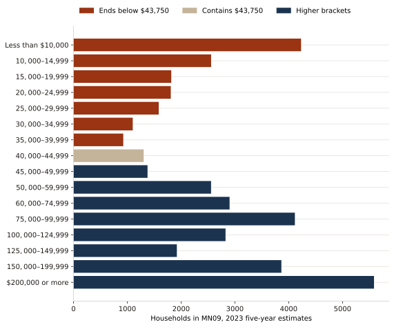
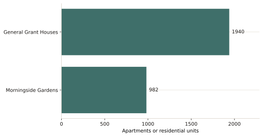

The analysis answers the affordability question in two steps. First it sets each tract's median household income next to the income limits used to market "affordable" housing. Then it counts the units in the projects the board is being asked to judge.

Everything is joined on census tract. A tract median comes from the census pipeline. A project is placed in the tract HPD records for that building. The service pipeline is separate: it produces the saturation index on the next page, and the report reads the two results together when it recommends where housing should be deeper and where services should move.

## Income limits as reference lines

Area Median Income is the federal benchmark housing programs use to describe a rent level. A unit is often called affordable when rent is at or below 30 percent of the income limit for its AMI band. The limits below are the New York City Area figures NYCHA published for 2025, for a household of three people.



These lines are limits for a three-person household. They are not the share of residents who qualify, and they are not a single median for the district. The chart places each tract median against the 30, 60, and 100 percent lines. A median below a line does not, by itself, mean the households in that tract are eligible for a unit at that band. Eligibility still depends on household size, rent, and the program's own rules.

The comparison is why the report rejects one AMI target for the whole district. Tract 219, in Manhattanville–West Harlem, has a 2023 median of $20,912. Tract 205, in Morningside Heights, has a median of $208,500. A unit priced from the regional limit sits in a different place relative to those two households.

Tract 217.03 is omitted from the chart because its median is suppressed.

## Households relative to those limits

The census table behind the next chart counts households in income brackets. It is the closest public count to a dollar line. Where a three-person limit falls inside a bracket, the bracket is left whole, so each line is reported as a range: households in brackets that end below the line, and households through the bracket that contains the line.



## Housing inventory

A project enters the unit total when HPD's Affordable Housing Production by Building dataset has the building. HPD's counted-units field is the affordable count. It stays in HPD's own income categories rather than being re-labeled into a new AMI band.



PS 186 is HPD project 51357 at 525 West 145 Street, census tract 229, completed on November 16, 2016: 79 total units, all 79 counted. Sunrose is the HPD row for 620 West 153 Street, census tract 237, completed on November 21, 2023: 238 total units, of which 72 are counted affordable. Together that is 317 total units and 151 counted affordable units.

1727 Amsterdam Avenue is a proposal in the Manhattan Borough President's recommendation of December 10, 2025 (C260071HAM, Block 2060 Lot 1). The recommendation describes approximately 200 units. The affordable split is not an exact count in the record used here, so those 200 units are not added to the 317.

The report reads this inventory against the income limits. Its test for a new project is whether the units are priced within reach of the host tract, with the deepest affordability reserved for the tracts whose medians sit farthest below the regional limits. That test is written out as tract standards on the [recommendations](report.qmd) page.

## How the pipelines meet

Census medians and HPD unit counts are the two inputs to the affordability reading. The saturation index then asks a different question of the same tracts: which ones already carry more of the district's supportive housing and safety-net services. The report uses both answers. A project can add deeply affordable homes and still be a poor place to add more supportive housing, if that tract is already where those services are concentrated.
