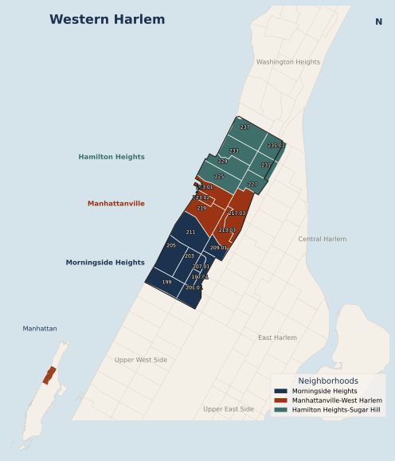

Western Harlem is Manhattan Community District 9, on the west side of northern Manhattan. The map is centered on the district. The inset shows where that district sits on the island. Tract lines are the 2020 census tracts. The three colors are the neighborhood tabulation areas inside the district: Morningside Heights, Manhattanville–West Harlem, and Hamilton Heights–Sugar Hill. Gray labels mark the Manhattan neighborhoods around them.

The table is the same set of tracts, with the Census Bureau's 2023 five-year estimates. Tract 217.03 has a population of 211 and a suppressed median household income, so that cell stays blank. The other medians are the published estimates, with the margin of error beside them. They are not averaged into a district median.


