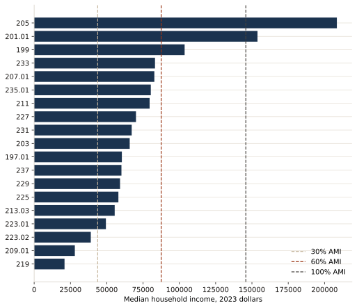
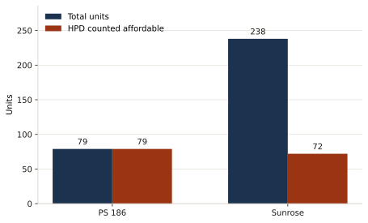

The analysis ends in actions for Community Board 9. The full report is the policy document. [Download the PDF](files/cb9-housing-analysis.pdf).

The recommendations below are the report's, in the order it gives them. They are negotiation baselines for the board. They are not approvals, and they are not instructions to a city agency.

## What the analysis is asking the board to see

**Incomes are not one number.** Household medians in Western Harlem run from about $21,000 in tract 219 to about $208,500 in tract 205. A unit marketed at a share of the regional income limit is within reach of one of those tracts and out of reach of the other. The chart is that comparison. The report's response is a tract-level affordability standard instead of one target for the whole district.

**Deep affordability is the test for the pipeline.** The report treats units at or below 60 percent of AMI, and units at or below 30 percent of AMI in the poorest tracts, as the homes that match current residents. It asks the board to support projects that add those homes and to treat projects priced mainly above that range as secondary unless they include a real deep-affordability share. The HPD buildings in the production total are PS 186 and Sunrose: 317 total units, 151 of them counted affordable. General Grant Houses and Morningside Gardens are existing buildings with their own counts on the analysis page, and they are not part of that sum. 1727 Amsterdam stays a proposal of about 200 units and is not part of it either.

**Services are uneven, so location is part of the decision.** The saturation index compares mental-health sites, supportive housing, and food pantries per 1,000 residents with the district average. The report uses a high index as a reason to pause new supportive housing, and a low index as a reason to steer services toward that tract. Housing stability and service access are read together: a new building does not fix a tract that has no outpatient mental-health clinic or no nearby food assistance.

## Five priorities

1. **Use tract-level AMI standards in every negotiation.** The report's baselines are 20–30 percent of AMI in the lowest-income Manhattanville tracts, 30–50 percent in other very low-income tracts, and 40–60 percent in higher-income Hamilton Heights tracts. A project whose rents sit out of reach of most households in the host tract should be opposed or conditioned on a deeper affordability mix.

2. **Judge projects by whether they close the deep-affordability gap.** The report estimates a shortfall on the order of 400 to 500 deeply affordable units over five years. It asks the board to support projects at or below 50–60 percent of AMI, and at or below 30 percent in tracts such as 219 and 229.

3. **Let the saturation index decide where supportive housing goes.** Pause new supportive housing in tracts the index places well above the district average. Direct support toward tracts the index places below it, and cite the index when the board testifies.

4. **Put two conditions on any supportive project.** Most of the units should be affordable to households at or below 30 percent of AMI where the tract median is below that kind of threshold, and the project should not deepen an already high saturation score. If it would, the report asks for mitigation or for a different tract.

5. **Make this the board's ordinary review, not a one-time memo.** The tiers and the tract standards below are the report's proposed standing test for the next project that comes to the board.

## How a project is sorted

| Tier | The project looks like | The report's stance |
| --- | --- | --- |
| 1 | Most units at 30–50 percent of AMI, with a service-equity commitment | Affirmative support |
| 2 | At least 40 percent of units at or below 60 percent of AMI, with a community-benefit agreement | Conditional support |
| 3 | A typical inclusionary mix in a tract that is already service-saturated | Oppose unless the mix is deepened or services are funded elsewhere in the district |
| 4 | Any project in a high-saturation tract | Require a contribution to services in an under-served tract |

## Tract standards

| Tract | What the report would require |
| --- | --- |
| 219, Manhattanville | At least 70 percent of units at or below 50 percent of AMI; mental-health and food access on site; a tenant-advocacy partner; local hiring |
| 221 | At least 60 percent of units at or below 50 percent of AMI; an outpatient mental-health clinic; a food program; a preference for CB9 residents |
| 209.01, Morningside Heights | At least half the units affordable and capped around 60 percent of AMI; local hiring; a contribution to services in tract 221 |

Hamilton Heights is treated as able to take a somewhat higher band, with 50–60 percent of AMI as the primary target and 60–80 percent only as a secondary tier. Workforce housing at 80–100 percent of AMI is the band the report treats as a poor match for current residents.

## Fair Share

The report asks the board to treat siting as a Fair Share question, using the Comptroller's audit MD22-101A. In that audit, BTP means beds-to-population. The actions the report asks for are procedural:

- Ask for a cumulative impact assessment before reviewing a new facility, covering added service demand and the district's saturation index.
- Use the community board's Charter review period rather than waiving it, with extra scrutiny where the saturation index is already high.
- When support is conditional, negotiate a geographic equity commitment: a matching service in an under-served tract, or a community-benefit contribution tied to supportive units above the citywide average.
- Publish a short Fair Share equity report each year: facilities sited, reviews completed, and the district's standing against the citywide average.

[Open the housing analysis PDF](files/cb9-housing-analysis.pdf).
