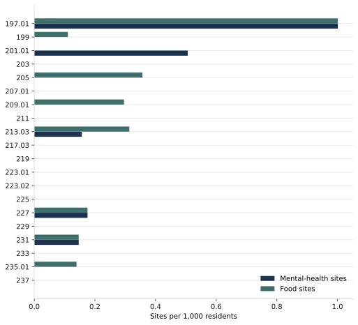

The Service Saturation Index is the report's composite for one equity question: which tracts carry more of the district's supportive housing, mental-health sites, and food pantries than the district average, relative to population.

It is a density index. It is not a count of supportive units divided by an eligible population, and it does not by itself say whether the stock exceeds modeled demand. The report uses it as a siting test: pause new supportive housing where the index is high, and steer it toward tracts where the index is low and the services are missing.

## Definitions

For tract *i*:

- **MH** is mental-health and behavioral-health sites per 1,000 residents.
- **SH** is permanent supportive housing units per 1,000 residents.
- **FP** is food pantries and emergency food providers per 1,000 residents.

The barred terms are the district averages of those same rates. Population, the denominator of each rate, comes from the census pipeline.

## How the index is calculated

```
SSI = (0.4 × MH / MH̄ + 0.4 × SH / SH̄ + 0.2 × FP / FP̄) × 100
```

Each term is a ratio. Divide the tract's rate by the district rate, weight the ratio, add the three weighted ratios, and multiply by 100.

An index of 100 means the tract matches the district average on this composite. The check is direct: if the tract's three rates equal the district rates, each ratio is 1, the weights sum to 1, and the index is 100. Above 100, the tract's composite rate is higher than the district average. Below 100, it is lower.

The weights are policy weights. Mental-health sites and supportive housing each receive 0.4 because the report treats them as the facilities with the heavier land-use and round-the-clock presence. Food pantries receive 0.2 because the report treats them as essential and smaller in footprint. The weights are not estimated from a regression. They sum to 1.

The rates themselves come from a count of sites or units in the tract, divided by the tract population, times 1,000. Mental-health sites and food sites are counted below from the NYC Facilities Database. The supportive-housing term is a unit count. That unit count is not in the facility file, so the index is not scored.

## Site counts

A mental-health site is an address with a facility type that names mental health, a psychosocial club, or on-site rehabilitation. A food site is an address whose type is a food pantry or a soup kitchen. A supportive-housing site is an address whose type names supported housing, a supported SRO, or NY/NY III supported housing. Program rows at one address count once. Feeding sites and rows labeled only as housing support are left out.





The formula still needs supportive-housing units per 1,000 residents before a tract can be scored. Counting a supportive-housing site as if it were a unit would change the index, so that substitution is not made. The bands below are how the report reads a score once the unit count exists.

## How a score is read

| Index | What it means | What the report asks the board to do |
| --- | --- | --- |
| Below 50 | Critically under-served | Priority for new services |
| 50–100 | Under-served | Support service expansion |
| 100–120 | Balanced | Neutral on new services |
| 120–150 | Approaching saturation | Conditional opposition |
| 150 and above | Over-saturated | Affirmative opposition |

The report's placement rule follows those bands. Supportive housing should not keep landing in the tract that already sits above the district composite. It should be directed toward the tracts the index marks as under-served, especially where mental-health care or food assistance is missing. Developer contributions, where the report calls for them, fund that shift rather than adding another facility in the concentrated tract.

The recommendations page turns those bands into the board actions: a pause on new supportive housing in the most concentrated tract, and priority for the tracts with the thinnest service layer.
